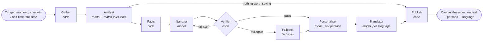

# The MatchMind agent system

Five roles, one Microsoft Agent Framework workflow, one rule: **models write, code checks, facts decide**. Language models choose the story and do the writing; they never compute a number. Every sentence that reaches a screen has passed the Verifier, or was built directly from fact-sheet lines.

## The workflow



Built with `WorkflowBuilder` (`agents/workflow.py`): switch-case edges for the Analyst's publish/skip decision and the Verifier's pass / revise / fall back routing. The Narrator → Verifier → Narrator cycle is the "recover from failures" loop.

| Step | Kind | Job |
|---|---|---|
| **Gather** | code | Match state + match fact sheet from match-intel (MCP). |
| **Analyst** | model, with MCP tools (`compare_to_expected`, `explain_event`, `get_player_card`) | Picks ONE story from the new moments and says why it matters, or decides nothing is worth a note. Structured output (`StoryPlan`); ids are validated against the input. |
| **Facts** | code | Fetches the fact sheets the plan needs (moment, team, player) and merges them with the match lines. |
| **Narrator** | model | Writes the neutral note from the fact lines only (`Note`: text + the fact keys used). |
| **Verifier** | code | `agents/verify.py`, below. Rejections go back to the Narrator with the reasons; a second failure falls back. |
| **Fallback** | code | The note made from fact lines themselves: always accurate, plainer to read. |
| **Personaliser** | model | Rewrites the verified note for each viewer: casual fan, analyst, home fan, away fan, optional player focus (`agents/personas.py`). Each version is verified again (with the fan's "we" bound to their club), retried once, else falls back to the neutral note. |
| **Translator** | model | Each persona version into each requested language. Checked for preserved numbers, banned content and length ratio; retried once, else English. |
| **Publish** | code | `OverlayMessage`s (the contract in `contracts/`): audience, language, priority, time-to-live, source moment, `verified=true`, and which step produced the text. |

**Shared state** is the `Job`: every step reads what earlier steps wrote and adds its part plus a **trace** entry (step, milliseconds, outcome, problems). The trace is saved with every note, so any sentence on screen can be traced back to its facts and checks.

## The Verifier's checks (`agents/verify.py`)

| Check | Catches |
|---|---|
| Every number is in the facts (at the text's precision; 42% ↔ 0.42) | invented or misremembered figures |
| **Attribution**: each number sits with the same team as in its fact line ("A lead 0.55 to 0.12" understood; a fan's "we" bound to their club) | right number, wrong team |
| No minute later than the clock | the future |
| No result language before full time ("won", "victory", "goalless draw"...) | premature results |
| No forecasting ("will score", "likely to break the deadlock") | speculation presented as fact |
| No names from other matches; no real clubs or competitions | leakage from the wider league; real-world IP (the league is fictional) |
| No betting language, hashtags, emoji, other sports' vocabulary | tone and brand safety |
| Direction words ("above their usual") must match a fact | contradicting the expectation baselines |
| Word limits per note type and persona | overlay space |

Twelve hand-written good and bad cases are unit tests (`tests/test_agents.py`).

## Failure recovery

- A model that times out, errors, or returns invalid JSON gets the deterministic alternative for its step: the Analyst's top-priority moment, the fact-line note, the neutral note for a persona, English for a translation.
- The workflow always publishes for a real trigger: **a failing model degrades the wording, never the accuracy**.
- Offline tests run the whole graph with scripted models: reject-then-fix, always-failing writer, crashing analyst.

## Models and providers (`agents/config.py`)

| | Local (now) | Microsoft Foundry (once connected) |
|---|---|---|
| Switch | `MM_AI_PROVIDER=ollama` | `MM_AI_PROVIDER=foundry` |
| Client | Agent Framework `OpenAIChatCompletionClient` → Ollama's OpenAI-compatible endpoint | Agent Framework `FoundryChatClient`, `DefaultAzureCredential` (az login / managed identity) |
| Fast tier (Narrator, Personaliser, Translator) | `qwen2.5:7b-instruct` | `FOUNDRY_FAST_DEPLOYMENT` (an OpenAI model) |
| Strong tier (Analyst) | `qwen2.5:7b-instruct` (14B fits, but not alongside the 7B in 8 GB) | `FOUNDRY_STRONG_DEPLOYMENT` (Claude via Foundry) |

Versions: Agent Framework core 1.22.0, OpenAI connector 1.17.0, Foundry connector 1.15.0. MCP SDK 1.30 (Agent Framework needs `mcp<2`; match-intel uses FastMCP from the same SDK).

## Running it

```
python -m agents run --home KIR --away NET --langs es,fr --max-notes 12
```

The runner starts match-intel as an HTTP MCP server (or uses `MM_MCP_URL`). It then moves the clock a minute at a time through `advance_match` and triggers the workflow:
- on new moments with priority ≥ 5
- after 15 quiet minutes (a state-of-play check-in)
- at half-time and full time (recaps)

Notes are printed and saved to `data/notes/<match>.jsonl` with their traces.

On the local 7B a note takes 11–22 s end to end, about 10 model calls: one Analyst, one or two Narrator, four Personaliser, four Translator (one language). A worked example with real Verifier catches: [examples/agents_local_run.md](examples/agents_local_run.md).

## Known limits

- **Meaning:** the checks guard numbers, names, time and tone, not every claim. A weak model can still write a loose sentence ("despite the scoreless draw"). Each such pattern seen so far became a rule.
- **Personas:** sometimes mix whole-match and recent figures.
- **Next:** stronger Foundry models, Foundry evaluations (groundedness, relevance) on a fixed eval set, and tracing in Application Insights.
