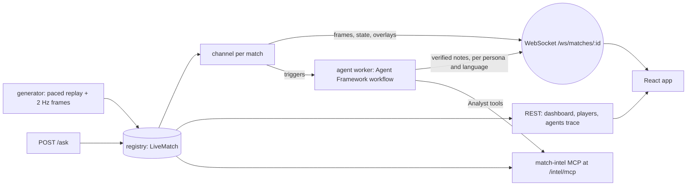

# API and web app

One process (`python -m api`, port 8000) holds the match registry and serves everything that reads it: the REST views, the live WebSocket feed, ask-this-view, the agent worker, the match-intel MCP endpoint (`/intel/mcp`), and the built web app (`/`). Because it's one process, the Analyst agent's MCP calls, the web views and the overlays all see the same live match.



## Endpoints

| Method | Path | Returns |
|---|---|---|
| GET | `/api/health`, `/api/config` | liveness; agents on/off, models, languages |
| GET | `/api/fixtures?round=` | the season's fixtures |
| POST | `/api/matches/start` `{match_id, speed, languages}` | starts (or joins) a live match with frames, a channel and the agent worker |
| GET | `/api/matches/{id}/state` | score, clock, xG, cards, win probability |
| GET | `/api/matches/{id}/dashboard` | analyst view: both teams' stats and vs-usual comparisons, phases, pass networks, 5-minute windows, win-probability history, value leaders, moments, the match fact sheet |
| GET | `/api/matches/{id}/players/{pid}` | player card |
| GET | `/api/matches/{id}/agents` | agent trace for recent notes (each step, timings, Verifier problems) |
| POST | `/api/matches/{id}/ask` `{question, tab, team_id?, player_id?, persona, lang}` | answer from the facts behind the current view, with the context that was sent |
| WS | `/ws/matches/{id}?persona=&lang=` | live feed (below) |
| — | `/intel/mcp` | match-intel MCP (streamable HTTP) |

## The WebSocket feed

Server → client: `{"type": ...}`

| type | data |
|---|---|
| `hello` | match meta, current state, available personas |
| `frame` | latest `PositionFrame` (sent each 0.25 s tick when it changed) |
| `state` | `MatchState` + win probability |
| `overlay` | an `OverlayMessage` (`contracts/models.py`). Deterministic: `moment_card`, `stat_tile`, `player_tag`. From the agents: `narrative` and `recap`, picked for the viewer: their persona + language, else their persona in English, else the neutral note. `replay: true` marks history sent on join or on a preference change. |
| `finished` | final state |

Client → server: `{"type": "prefs", "persona", "lang", "focus_player"}` switches persona, language or followed player on the open socket, and replays recent notes in the new choice. When a viewer follows a player, the agent worker adds a player-focus persona for that player.

**The agent worker** runs one note at a time per match:
- Triggers: priority ≥ 5 moments, a 15-minute check-in, half-time, full time.
- A backlog is merged into one note, and moments more than 6 match minutes old are folded in, so slow models don't fall behind the match.

## Ask about this view

The view decides the facts: the match sheet, plus the team sheet on a team panel or the player sheet in player focus. The answerer model must answer only from those lines, or say the screen can't answer it. Its answer goes through the same Verifier as the notes, with one retry. If it still fails, the reply is the most relevant fact lines verbatim. The response lists exactly what was sent to the model, which the UI can show.

## Web app (`web/`, React 18 + TypeScript + Vite, no UI libraries)

| View | What it shows |
|---|---|
| **Fixtures** | the season by round; pick a match and a speed (10× by default: about 9 minutes per match) |
| **Broadcast** | SVG pitch from the 2 Hz frames (kit colours chosen for contrast on the grass and against the opponent), score bug, win-probability bar, moment cards that expire, speed tags, the live-notes feed for the chosen viewer and language (with *verified* / *from facts* / *English* badges), ask box |
| **Analyst** | team comparison with "vs their usual" chips, xG flow, win-probability area chart, rhythm (field tilt bars + chaos index), pass network per team, phases, possession-value leaders, moments |
| **Player focus** | squad list, pitch with the player ringed, player card (passing, shooting, take-ons, defending, possession value, distance, top speed, sprints), ask with player context; choose "Player focus" as the viewer for notes centred on them |
| **Agents** | the trace of every note (steps, timings, Verifier rejections in red), models in use, and the fact sheet the agents write from |

Viewer choices: Casual fan, Analyst, Home fan, Away fan, Player focus. Languages: English plus Spanish, French, Portuguese, German, Italian, Japanese and Arabic. Up to three translated languages are produced per match (set when the match starts); others fall back to English.

## Running locally

```
cd web && npm install && npm run build      # once, or after UI changes
python -m api                               # http://127.0.0.1:8000
# UI development with hot reload: python -m api, then in web/: npm run dev  -> http://localhost:5173
```

`MM_AGENTS=off` runs without models: deterministic overlays and fact-line answers only (this is how the tests run in CI). With Ollama on one laptop GPU, each note takes 12–60 s depending on what's queued, and ask-this-view waits behind notes. Use 10× speed or slower; Foundry removes the queue.
